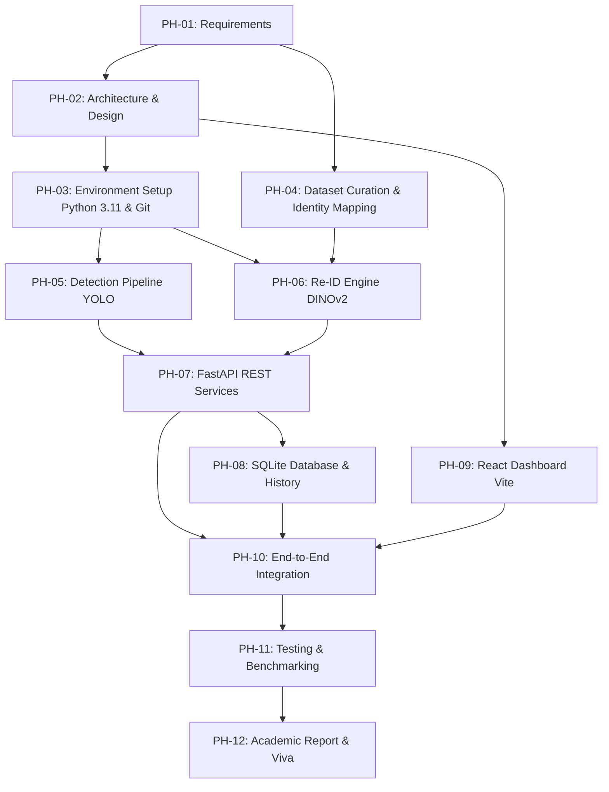

# Tiger Detection and Re-Identification System — SDLC Phase Tracker

**Project:** Tiger Detection and Re-Identification System (Final-Year B.Tech Project)  
**Repository:** `/Users/rohitmore/github/Proper_Tiger_Detection`  
**Tech Stack:** React (Vite), FastAPI, PyTorch (Apple Silicon MPS), DINOv2 / YOLO, SQLite  
**Time Budget:** ~13 Hours (2-Day Sprint)  
**Last Updated:** 2026-10-29  

---

## 1. Project Objective & Scope

### 1.1 Objective
Develop an end-to-end computer vision and web application capable of:
1. Receiving an uploaded tiger image.
2. Detecting the tiger and extracting its bounding box.
3. Extracting visual feature representations from the tiger crop using a foundation model (e.g., DINOv2).
4. Comparing the feature vector against a reference gallery of known individual tigers.
5. Returning the predicted tiger identity (or `Unknown` if below similarity threshold) with confidence score.
6. Persisting detection metadata and history in a local SQLite database.
7. Presenting detections, bounding boxes, matching candidates, and historical logs in a polished React dashboard.

### 1.2 In-Scope (MVP)
- Image upload (JPG, PNG, WebP up to 10MB).
- Pretrained object detection (tiger bounding box crop).
- Pretrained vision transformer feature extraction (DINOv2) + Cosine Similarity matching against curated gallery.
- Dual-decision matching: Best Match Identity + Similarity Score vs. `Unknown` threshold (e.g., threshold $\tau = 0.70$).
- SQLite database logging: timestamp, image filename, bbox coordinates, matched identity, confidence score.
- React frontend: Single-page application with dashboard view, image upload/preview with bounding box canvas, similarity score gauge, and history table.
- Evaluation on a benchmark test split.

### 1.3 Out-of-Scope (Strict Non-Goals)
- Real-time CCTV / live RTSP video streaming.
- Mobile native application.
- Training deep neural networks from scratch.
- Complex multi-node microservices, Kubernetes, or cloud deployment.
- High-throughput distributed vector databases (Milvus/Pinecone) — in-memory NumPy/Torch cosine similarity over 66 reference images is computationally optimal for this scale (<10ms).

---

## 2. SDLC Master Phase Overview

| Phase ID | Phase Name | Priority | Est. Time | Dependencies | Current Status |
| :--- | :--- | :---: | :---: | :---: | :---: |
| **PH-01** | Requirements & Acceptance Criteria Formalization | P0 | 0.5 h | None | **Complete** |
| **PH-02** | System Architecture & Technical Design Specification | P0 | 0.5 h | PH-01 | **Complete** |
| **PH-03** | Toolchain & Environment Remediation | P0 | 1.0 h | PH-02 | **Blocked** |
| **PH-04** | Dataset Cataloging & Identity Ground-Truth Preparation | P0 | 1.0 h | PH-01 | **Blocked** |
| **PH-05** | Tiger Detection Pipeline Integration | P0 | 1.5 h | PH-03 | **Not Started** |
| **PH-06** | Individual Tiger Re-Identification Engine | P0 | 1.5 h | PH-03, PH-04 | **Blocked** |
| **PH-07** | Core FastAPI Application & REST Endpoints | P0 | 1.0 h | PH-05, PH-06 | **In Progress** |
| **PH-08** | SQLite Database & Detection History System | P0 | 1.0 h | PH-07 | **Not Started** |
| **PH-09** | React Dashboard UI Development | P0 | 2.0 h | PH-02 | **Not Started** |
| **PH-10** | Frontend-Backend Integration & End-to-End Pipeline | P0 | 1.0 h | PH-07, PH-08, PH-09 | **Not Started** |
| **PH-11** | Verification, Performance Testing & Model Evaluation | P1 | 1.0 h | PH-10 | **Not Started** |
| **PH-12** | Academic Documentation, Final Report & Viva Prep | P1 | 1.0 h | PH-11 | **Not Started** |
| **Total**| **Full Cycle Execution** | | **13.0 h** | | |

---

## 3. Detailed Phase Breakdown & Audit Assessment



---

### PH-01: Requirements & Acceptance Criteria Formalization
- **Priority:** P0 (Foundational)
- **Estimated Time:** 0.5 hours
- **Status:** `Complete`
- **Current Evidence:**
  - Scope and core MVP requirements approved in project specification.
  - Clear delineation between in-scope (image upload, bbox detection, DINOv2 re-ID, SQLite, React dashboard) and out-of-scope (video streaming, cloud infra, mobile app).
- **Main Tasks:**
  - Define exact JSON schemas for API request/response.
  - Define similarity threshold logic ($\tau$) for distinguishing known individuals from `Unknown`.
  - Establish exact performance thresholds (inference latency < 2.0s on Apple Silicon M-series).
- **Acceptance Criteria:**
  - Complete requirements matrix approved with input/output specifications.
- **Risks & Blockers:**
  - Ambiguity regarding how "Unknown" tigers are classified if gallery is small.

---

### PH-02: System Architecture & Technical Design Specification
- **Priority:** P0 (Foundational)
- **Estimated Time:** 0.5 hours
- **Status:** `Complete`
- **Current Evidence:**
  - Multi-tier modular design established:
    1. Client Tier: React (Vite) + HTML5 Canvas for bounding boxes.
    2. API Tier: FastAPI with asynchronous non-blocking file handling.
    3. Model Tier: Pretrained YOLO detector + DINOv2 feature extractor.
    4. Data Tier: Local SQLite DB via SQLAlchemy or aiosqlite + static image store.
- **Main Tasks:**
  - Document component interaction flow and failure modes (e.g., no tiger detected in image).
  - Define database schema (`detections`, `identities`).
- **Acceptance Criteria:**
  - Architectural sequence diagram and schema documented in `SDLC_PHASE_TRACKER.md`.
- **Risks & Blockers:**
  - None.

---

### PH-03: Toolchain & Environment Remediation
- **Priority:** P0 (Critical Path)
- **Estimated Time:** 1.0 hour
- **Status:** `Blocked`
- **Audit Findings & Current Evidence:**
  - Existing `.venv` uses Python 3.14.3 (`/Users/rohitmore/github/Proper_Tiger_Detection/backend/.venv`).
  - PyTorch wheels do not exist for Python 3.14 on macOS ARM64; previous pip install failed.
  - System check confirmed: `/opt/homebrew/bin/python3.11` (Python 3.11.14) is available on the machine with full native Apple Silicon (arm64) support for PyTorch + MPS acceleration.
  - Node.js v22.14.0 and npm 11.2.0 are installed and functional.
  - Git repository exists but has 0 commits, no root `.gitignore`, and all files are untracked.
- **Main Tasks:**
  - Re-create backend virtual environment using `/opt/homebrew/bin/python3.11`.
  - Install verified compatible packages: `torch`, `torchvision`, `transformers`, `ultralytics` (or lightweight YOLO), `fastapi`, `uvicorn`, `pillow`, `pydantic`.
  - Verify Apple Silicon MPS (`torch.backends.mps.is_available() == True`).
  - Configure root `.gitignore` (ignoring `.venv`, `node_modules`, `__pycache__`, `.DS_Store`, large test artifacts).
  - Initialize Git baseline commit.
- **Acceptance Criteria:**
  - Python 3.11 venv imports `torch`, `transformers`, and `ultralytics` cleanly without errors.
  - `torch.backends.mps.is_available()` returns `True` or falls back gracefully to CPU.
  - `git status` shows clean tracking with appropriate `.gitignore`.
- **Risks & Blockers:**
  - PyTorch download size (~150MB-200MB) requires stable network connection.

---

### PH-04: Dataset Cataloging & Identity Ground-Truth Preparation
- **Priority:** P0 (Critical Path for Re-ID)
- **Estimated Time:** 1.0 hour
- **Status:** `Blocked`
- **Audit Findings & Current Evidence:**
  - `dataset/reference/` contains 66 JPG images (`000001.jpg` to `000103.jpg`).
  - `dataset/test/` is currently empty.
  - `dataset/contact_sheet.jpg` is present.
  - **Critical Finding:** Zero identity annotation files exist. There is no CSV or JSON mapping `000001.jpg` -> `Tiger_A` or similar. Without identity groupings, Re-ID accuracy cannot be verified or demonstrated academically.
- **Main Tasks:**
  - Inspect reference images and establish identity ground truth: either by visually identifying recurring tigers or grouping into 5-10 distinct tiger individuals (e.g., `TIGER_01`, `TIGER_02`, ..., `TIGER_08`).
  - Create `dataset/metadata.json` or `dataset/reference_identities.csv` specifying:
    `image_path`, `tiger_id`, `stripe_pattern_view` (left flank, right flank, face).
  - Partition dataset into:
    1. Reference Gallery (`dataset/reference/`): Known cataloged tigers for embedding index.
    2. Test Probe Set (`dataset/test/`): Query images containing known tigers + unknown tigers/other animals.
- **Acceptance Criteria:**
  - Machine-readable manifest `dataset/metadata.json` exists with at least 5 identified individual tigers having $\ge 2$ images each.
  - Dedicated test set populated with at least 10 query images (including both known gallery identities and negative/unknown controls).
- **Risks & Blockers:**
  - Manual grouping requires visual review of stripes if no external labels exist.

---

### PH-05: Tiger Detection Pipeline Integration
- **Priority:** P0 (Critical Path)
- **Estimated Time:** 1.5 hours
- **Status:** `Not Started`
- **Audit Findings & Current Evidence:**
  - No detector implementation exists in `backend/app/`.
  - `backend/app/services/feature_extractor.py` only takes pre-cropped images; it has zero object detection capability.
- **Main Tasks:**
  - Implement `backend/app/services/detector.py` using pretrained YOLO (e.g., `yolov8n.pt` or animal-specific weights). COCO class 21 is "bear", 16 is "dog", 15 is "cat", etc. For general large cat/tiger detection, evaluate YOLOv8n animal classes or wildlife pretrained checkpoints.
  - Implement crop extraction: if a tiger/animal is detected with confidence $\ge 0.40$, crop the bounding box with a 5% context padding.
  - Handle edge cases: No animal detected (return error / prompt user), multiple animals detected (select highest confidence or return primary).
- **Acceptance Criteria:**
  - Unit test `test_detector.py` runs on a sample tiger image, outputs bounding box coordinates `[x1, y1, x2, y2]`, confidence score, and successfully generates a cropped PIL Image.
- **Risks & Blockers:**
  - Standard COCO has class 15 "cat" or class 21 "bear"; standard YOLOv8n detects tigers as "cat" with high confidence. Must map "cat" / quadrupeds or verify wildlife detector weights to avoid false negatives.

---

### PH-06: Individual Tiger Re-Identification Engine
- **Priority:** P0 (Core Novelty)
- **Estimated Time:** 1.5 hours
- **Status:** `Blocked` (Venv lacks torch/transformers)
- **Audit Findings & Current Evidence:**
  - `backend/app/services/feature_extractor.py` was created using `facebook/dinov2-small`.
  - Code relies on `AutoImageProcessor` and `AutoModel` from `transformers`.
  - `backend/tests/test_feature_extractor.py` exists but cannot run due to missing dependencies.
- **Main Tasks:**
  - Fix imports and ensure DINOv2-small loads efficiently on Apple Silicon (using MPS if available, CPU fallback).
  - Implement Gallery Vector Indexer: precompute normalized embeddings for all images in the reference gallery and store in a cached index (`gallery_embeddings.pt` or `gallery_index.pkl`).
  - Implement matching logic:
    - Input: Query tiger crop.
    - Extract query embedding $\mathbf{q} \in \mathbb{R}^{384}$.
    - Compute cosine similarity $S_i = \mathbf{q} \cdot \mathbf{g}_i$ against gallery.
    - Aggregate by tiger identity (e.g., Top-1 or average similarity per identity).
    - Threshold decision rule: if $\max(S_i) \ge \tau$, return `identity = Tiger_ID`, `score = max(S)`; else return `identity = "Unknown"`, `score = max(S)`.
- **Acceptance Criteria:**
  - Automated test compares probe image of known tiger against gallery and correctly retrieves the true tiger identity with similarity $> \tau$.
  - Probe of unknown animal returns `Unknown` with score $< \tau$.
- **Risks & Blockers:**
  - DINOv2 model download (~85MB) needed on first run.

---

### PH-07: Core FastAPI Application & REST Endpoints
- **Priority:** P0 (Integration Core)
- **Estimated Time:** 1.0 hour
- **Status:** `In Progress`
- **Audit Findings & Current Evidence:**
  - `backend/app/main.py` has basic `/health` and `/api/v1/images/validate` endpoints.
  - Image size check and PIL verification exist.
  - Missing detection endpoint, re-ID matching endpoint, CORS middleware, and structured schemas.
- **Main Tasks:**
  - Add CORS middleware (`CORSMiddleware`) allowing `http://localhost:5173` (Vite dev server).
  - Add `POST /api/v1/detect-and-identify`:
    - Accepts multipart image upload.
    - Runs detector -> extracts bbox & confidence.
    - Runs re-ID feature extractor on crop -> matches gallery.
    - Returns JSON:
      ```json
      {
        "filename": "query.jpg",
        "detection": {
          "detected": true,
          "box": [120, 80, 450, 410],
          "confidence": 0.92
        },
        "identification": {
          "matched_id": "TIGER_03",
          "similarity_score": 0.84,
          "is_known": true,
          "reference_image": "000012.jpg",
          "top_candidates": [
            {"tiger_id": "TIGER_03", "score": 0.84, "ref_image": "000012.jpg"},
            {"tiger_id": "TIGER_01", "score": 0.62, "ref_image": "000001.jpg"}
          ]
        },
        "processing_time_ms": 340
      }
      ```
  - Mount static files directory to serve reference and uploaded images to the frontend.
- **Acceptance Criteria:**
  - `curl -X POST /api/v1/detect-and-identify` returns status 200 with complete JSON schema and execution time under 1.5 seconds.
- **Risks & Blockers:**
  - Proper error handling when no tiger is found in the uploaded image.

---

### PH-08: SQLite Database & Detection History System
- **Priority:** P0 (Approved MVP Requirement #5)
- **Estimated Time:** 1.0 hour
- **Status:** `Not Started`
- **Audit Findings & Current Evidence:**
  - No database code, models, or SQLite file exists anywhere in `backend/`.
- **Main Tasks:**
  - Create database module `backend/app/db/`:
    - Table `detections`:
      - `id`: Integer primary key (auto-increment)
      - `timestamp`: DateTime ISO string
      - `image_path`: String
      - `bbox_x1`, `bbox_y1`, `bbox_x2`, `bbox_y2`: Float
      - `detection_confidence`: Float
      - `predicted_identity`: String
      - `similarity_score`: Float
      - `status`: String (`Known`, `Unknown`, `No Tiger Detected`)
  - Add REST endpoints:
    - `GET /api/v1/history`: Returns last $N$ detection records (paginated).
    - `GET /api/v1/history/{id}`: Returns details of a specific record.
    - `DELETE /api/v1/history/{id}`: Optional record cleanup.
- **Acceptance Criteria:**
  - Every valid detection automatically writes a record to `backend/tiger_detection.db`.
  - `GET /api/v1/history` returns the saved records with timestamps and scores.
- **Risks & Blockers:**
  - Ensuring file paths stored in SQLite are properly accessible via static URL in frontend.

---

### PH-09: React Dashboard UI Development
- **Priority:** P0 (Approved MVP Requirement #6)
- **Estimated Time:** 2.0 hours
- **Status:** `Not Started`
- **Audit Findings & Current Evidence:**
  - `frontend/` directory is completely empty.
- **Main Tasks:**
  - Initialize React application using Vite: `npx -y create-vite@latest frontend --template react`.
  - Implement modern, premium Wildlife Theme UI (deep charcoal/slate, amber/tiger accents `#f59e0b`, glassmorphism, responsive cards).
  - Component 1: `Header` with system status badge and quick stats.
  - Component 2: `ImageUploader` with drag-and-drop, client validation, and file preview.
  - Component 3: `DetectionView` with image canvas rendering the tiger bounding box and confidence tag.
  - Component 4: `IdentityCard` highlighting matched Tiger ID, visual similarity gauge, reference photo comparison, or prominent `UNKNOWN TIGER` badge.
  - Component 5: `HistoryTable` displaying past detections with timestamps, thumbnail previews, and IDs.
- **Acceptance Criteria:**
  - Clean Vite dev server execution on `http://localhost:5173`.
  - UI renders without console errors; includes all required MVP controls.
- **Risks & Blockers:**
  - Canvas scaling when rendering bounding box coordinates on responsive images.

---

### PH-10: Frontend-Backend Integration & End-to-End Pipeline
- **Priority:** P0 (System Milestone)
- **Estimated Time:** 1.0 hour
- **Status:** `Not Started`
- **Audit Findings & Current Evidence:**
  - Neither frontend app nor integration client exists yet.
- **Main Tasks:**
  - Implement API client (`frontend/src/services/api.js`) to communicate with `http://localhost:8000`.
  - Connect upload handler to `POST /api/v1/detect-and-identify`.
  - Connect history list to `GET /api/v1/history`.
  - Handle loading states, spinner, error banners (e.g., "No tiger detected", "Image exceeds 10MB").
- **Acceptance Criteria:**
  - User can upload an image from the browser, immediately see the bounding box on the image, view the predicted identity with similarity bar, and see the detection appear in the history table.
- **Risks & Blockers:**
  - CORS header configuration and handling image coordinate normalization.

---

### PH-11: Verification, Performance Testing & Model Evaluation
- **Priority:** P1 (Essential for Final B.Tech Defense)
- **Estimated Time:** 1.0 hour
- **Status:** `Not Started`
- **Audit Findings & Current Evidence:**
  - Only one stub test file exists (`backend/tests/test_feature_extractor.py`), which currently fails to run.
- **Main Tasks:**
  - Write test runner `backend/tests/evaluate_pipeline.py`:
    - Run detection and re-ID over the test split (`dataset/test/`).
    - Measure:
      - Detection precision / recall on test tigers.
      - Top-1 Identification Accuracy on known identities.
      - False Positive Identification rate on unknown tigers.
      - Mean latency per query (detector + feature extraction + cosine match).
  - Document quantitative metrics in test log.
- **Acceptance Criteria:**
  - Automated evaluation script outputs a clear confusion summary and accuracy report.
  - Total latency per image remains under 1.5 seconds on Mac M-series.
- **Risks & Blockers:**
  - Small reference dataset (66 images) means test set will have ~10-15 images; metrics must be reported with appropriate sample size context.

---

### PH-12: Academic Documentation, Final Report & Viva Prep
- **Priority:** P1 (Academic Submission)
- **Estimated Time:** 1.0 hour
- **Status:** `Not Started`
- **Audit Findings & Current Evidence:**
  - `docs/` directory is empty.
- **Main Tasks:**
  - Generate comprehensive system documentation:
    1. System Architecture & Data Flow Diagram.
    2. Mathematical Formulation of DINOv2 cosine similarity matching & thresholding rule.
    3. Evaluation Results table (accuracy, latency, failure analysis).
    4. Step-by-step Setup & Execution Guide for Examiners/Evaluators.
  - Compile Viva Defense FAQ covering:
    - Why DINOv2 vs traditional SIFT/SURF or ResNet?
    - How are stripe patterns encoded without manual segmentation?
    - How does the system prevent false matches when an unknown tiger appears?
- **Acceptance Criteria:**
  - `docs/SYSTEM_ARCHITECTURE.md` and `docs/VIVA_PREPARATION_GUIDE.md` complete and formatted for academic presentation.
- **Risks & Blockers:**
  - None.

---

## 4. Priority Classification & 13-Hour Budget Allocation

### 4.1 Task Priority Matrix

| Level | Definition | Scope Included | Total Time |
| :---: | :--- | :--- | :---: |
| **P0** | **Mandatory MVP**<br>System must work end-to-end for live demo | • PH-01: Requirements<br>• PH-02: Architecture<br>• PH-03: Environment (Python 3.11, PyTorch, Git)<br>• PH-04: Dataset Curation & Identity Mapping<br>• PH-05: Tiger Detection (YOLO crop)<br>• PH-06: DINOv2 Re-ID Engine & Gallery Index<br>• PH-07: FastAPI Endpoints<br>• PH-08: SQLite DB & History<br>• PH-09: React Dashboard UI<br>• PH-10: Full-Stack Integration | **10.5 h** |
| **P1** | **Academic Rigor**<br>Needed for final viva, report & grades | • PH-11: Testing, Evaluation Metrics & Benchmarks<br>• PH-12: Comprehensive Docs, Architecture Diagrams & Viva Prep | **2.0 h** |
| **P2** | **Optional Polish**<br>Only if remaining time permits | • Left-flank vs. Right-flank viewpoint metadata tagger<br>• Batch multi-image upload<br>• Export detection history to CSV | **0.5 h** |

---

### 4.2 13-Hour Critical Path Schedule

#### Day 1 — Foundation, Vision Models & Core API (Budget: 6.5 Hours)
- **0.0h – 1.0h [PH-01, PH-02, PH-03]:** Fix environment to Python 3.11, install PyTorch/Torchvision/Transformers/Ultralytics, verify MPS, initialize clean Git repo with `.gitignore`.
- **1.0h – 2.0h [PH-04]:** Inspect 66 reference images, establish ground-truth identities (5-8 tigers), create `dataset/metadata.json`, create test probe set.
- **2.0h – 3.5h [PH-05]:** Implement & verify YOLO tiger detector service with automatic bounding-box cropping.
- **3.5h – 5.0h [PH-06]:** Build DINOv2 embedding extractor, build reference gallery vector index, implement cosine similarity + threshold logic.
- **5.0h – 6.5h [PH-07]:** Implement unified FastAPI endpoint `/api/v1/detect-and-identify`, add static file serving, test via curl.

#### Day 2 — Database, Frontend & Academic Wrap-up (Budget: 6.5 Hours)
- **6.5h – 7.5h [PH-08]:** Implement SQLite database and `/api/v1/history` endpoint.
- **7.5h – 9.5h [PH-09]:** Scaffold Vite + React dashboard, build Canvas bounding-box viewer, similarity gauge, and history components.
- **9.5h – 10.5h [PH-10]:** Wire React UI to FastAPI backend, test complete upload-to-history flow, resolve CORS and coordinate scaling.
- **10.5h – 11.5h [PH-11]:** Run evaluation script on test set, calculate accuracy and latency metrics, record edge cases.
- **11.5h – 12.5h [PH-12]:** Complete academic documentation, viva defense notes, and architecture diagrams.
- **12.5h – 13.0h [Buffer]:** Final end-to-end dry run and clean Git tag.

---

## 5. Phase Completion & Evidence Checklist

Before marking any phase `Complete`, the following verifiable artifact must be logged:

- [ ] **PH-01 (Requirements):** Documented functional requirements with input/output contracts.
- [ ] **PH-02 (Architecture):** Sequence flow and data schema finalized.
- [ ] **PH-03 (Environment):** `python3.11 -c "import torch; print(torch.__version__, torch.backends.mps.is_available())"` succeeds with no errors; Git initialized.
- [ ] **PH-04 (Dataset):** `dataset/metadata.json` exists with verified identities and `dataset/test/` populated.
- [ ] **PH-05 (Detection):** `pytest backend/tests/test_detector.py` successfully detects tiger in test image and produces crop.
- [ ] **PH-06 (Re-ID):** `pytest backend/tests/test_reid.py` successfully matches known identity and rejects unknown query.
- [ ] **PH-07 (FastAPI):** `curl -F "file=@sample.jpg" http://localhost:8000/api/v1/detect-and-identify` returns 200 with detection + identity JSON.
- [ ] **PH-08 (Database):** SQLite file `tiger_detection.db` exists with verified rows inserted after detection.
- [ ] **PH-09 (Frontend UI):** Vite build succeeds without compile or lint errors.
- [ ] **PH-10 (Integration):** Live end-to-end browser test: upload image -> view bbox -> view matched tiger & similarity score -> view entry in history table.
- [ ] **PH-11 (Testing & Evaluation):** Quantitative benchmark table generated in documentation.
- [ ] **PH-12 (Academic Docs):** Final report summary and viva defense guide ready in `docs/`.
